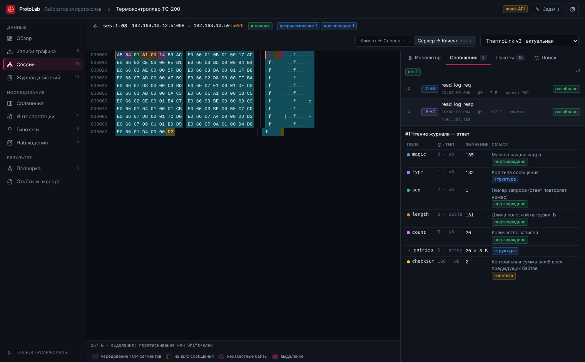
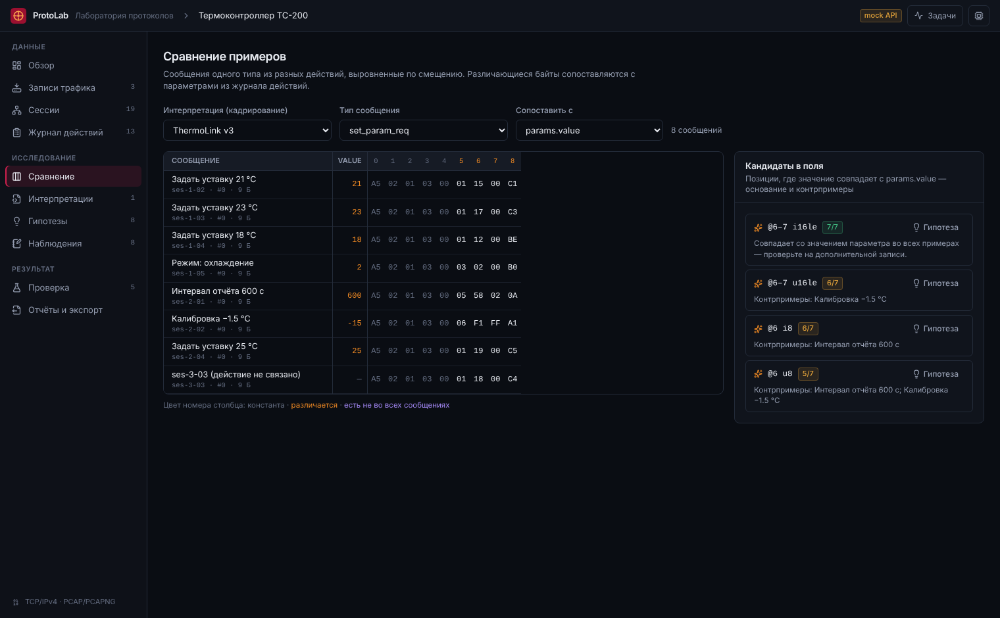
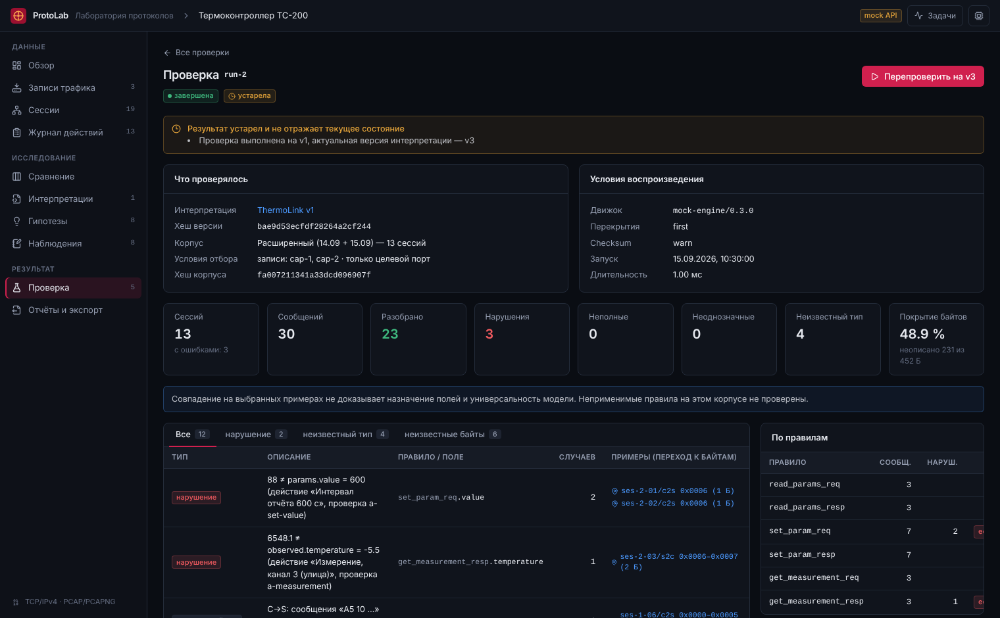
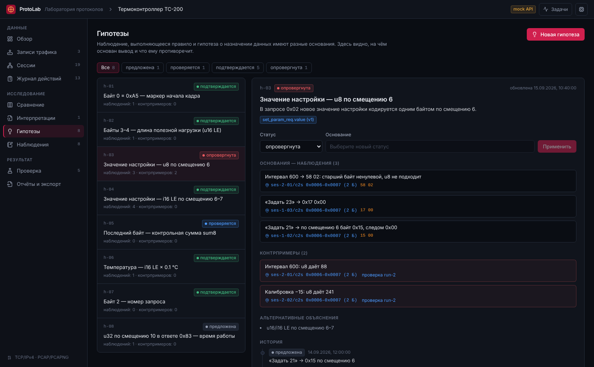

# ProtoLab — frontend

React-интерфейс «Лаборатории протоколов»: исследование недокументированного бинарного обмена
поверх TCP. Здесь открываются PCAP/PCAPNG, изучаются потоки, сравниваются примеры, формулируются
и версионируются интерпретации, проверяются гипотезы на корпусе, формируется отчёт и передаётся проект.

| Поток сессии: hex, сообщения, поля | Сравнение примеров и кандидаты в поля |
|---|---|
|  |  |
| **Проверка: устаревание, контрпримеры, переход к байтам** | **Гипотезы: основания, контрпримеры, история** |
|  |  |

## Стек

| Задача | Выбор |
|---|---|
| Сборка | Vite 7, TypeScript 5.9 (strict) |
| UI | React 19, Tailwind CSS 4, lucide-react; системные шрифты (работает офлайн) |
| Роутинг | React Router 7, ленивые страницы (code splitting) |
| Серверное состояние | TanStack Query 5 (`queryOptions`-фабрики в entities) |
| Клиентское состояние | Zustand (только тосты); остальное — URL и локальный state |
| Hex-просмотр | @tanstack/react-virtual (виртуализация потоков большого размера) |
| Моки | MSW 2: API эмулируется в браузере, фронтенд работает без backend |
| Качество | ESLint 9 (с правилами границ слоёв FSD), Vitest |

## Быстрый старт

```bash
npm ci
npm run dev:mock     # http://localhost:5173 — mock API с демо-проектом, backend не нужен
npm run dev          # API проксируется на Go backend (VITE_API_PROXY_TARGET, по умолчанию :8080)

npm run typecheck && npm run lint && npm test
npm run build        # → dist/, встраивается в Go-бинарник (см. ../docs/api.md)
npm run build:demo   # статическая сборка с mock API (демо без backend)
```

Переменные окружения (`.env.*`):

| Переменная | Назначение |
|---|---|
| `VITE_API_BASE_URL` | базовый путь API, по умолчанию `/api/v1` |
| `VITE_API_MOCKS` | `true` — включить MSW-моки |
| `VITE_API_PROXY_TARGET` | адрес backend для dev-прокси |

## Архитектура: Feature-Sliced Design

```text
src/
├── app/          # инициализация: провайдеры, роутер, лейауты, глобальные стили
├── pages/        # страницы-маршруты: только композиция виджетов и фич
├── widgets/      # самостоятельные блоки UI (hex-просмотр, таблицы, панели)
├── features/     # пользовательские действия (загрузить запись, создать наблюдение…)
├── entities/     # бизнес-сущности: типы (= контракт API), запросы, мелкий UI
├── shared/       # инфраструктура без бизнес-логики: http-клиент, утилиты, UI-кит
└── mocks/        # MSW: генератор демо-данных и эталонный движок интерпретаций
```

Правила, которые проверяет ESLint (`eslint.config.js`):

- слой импортирует только нижележащие слои: `app → pages → widgets → features → entities → shared`;
- слайс импортируется только через публичный API — `@/entities/session`, а не `@/entities/session/api/...`;
- фичи не зависят друг от друга — композиция происходит в виджетах и на страницах;
- моки зависят только от `shared` и типов `entities`.

Внутри слайса сегменты: `model/` (типы, константы, хуки состояния), `api/` (запросы + `queryOptions`),
`ui/` (компоненты), `index.ts` (публичный API).

### Сущности и контракт API

Типы в `entities/*/model/types.ts` — это контракт с Go-бэкендом. Полное описание эндпоинтов и
обязательной семантики находится в [`../docs/api.md`](../docs/api.md), формат спецификаций — в
[`../docs/interpretation-format.md`](../docs/interpretation-format.md).

| Сущность | Что это |
|---|---|
| `project` | проект исследования и настройки восстановления потоков |
| `capture` | исходная запись (неизменяемая, SHA-256, диагностика) |
| `session` | экземпляр TCP-соединения |
| `stream` | восстановленный направленный поток: сегменты, пропуски, конфликты, пакеты |
| `message` | прикладное сообщение после кадрирования и разбора полей |
| `action` | журнал действий в штатном клиенте (условия эксперимента) |
| `interpretation` | спецификация `protolab/v1` и её неизменяемые версии |
| `hypothesis`, `observation` | предположения и факты, привязанные к байтам (`SourceRef`) |
| `corpus`, `verification` | наборы сессий, запуски проверки, находки |
| `report`, `job`, `system` | артефакты отчётов, фоновые задачи, ресурсы backend |

### Ключевые принципы UI (из ТЗ)

- **Происхождение.** Любой вывод ведёт к исходным байтам: `SourceRefLink` открывает сессию с
  выделенным диапазоном (`?dir=&sel=offset:length&v=`). Ссылками можно делиться.
- **Неизвестное не равно нулю.** Пропуски в записи рисуются штриховкой и `??`, поиск значений их
  игнорирует, а инспектор не вычисляет по ним значения.
- **Гипотеза ≠ подтверждение.** У каждого поля виден статус смысла (`структура / гипотеза / подтверждено`),
  у каждой гипотезы — основания, контрпримеры и история смены статуса.
- **Устаревание.** Проверки старых версий интерпретации помечаются «устарела» с указанием причин.
- **Долгие операции.** Импорт, проверка и отчёт выполняются фоновыми задачами: виден прогресс,
  задачу можно отменить, уже готовые данные остаются доступны.

## Mock-режим

`npm run dev:mock` поднимает MSW-воркер с демо-проектом «Термоконтроллер TC-200». В демо-данных
синтетический протокол ThermoLink: кадры `A5 | type | seq | len u16le | payload | sum8`. Есть три
записи: основная, дополнительная с контрпримерами и запись с дефектами захвата (потеря сегмента,
усечение snaplen, конфликт ретрансмиссии, отсутствие начала соединения, checksum offloading).
Также в демо есть журнал действий, три версии интерпретации, гипотезы и пять проверок.

- `mocks/fixtures/` — детерминированный генератор TCP-сессий и пакетов с дефектами;
- `mocks/engine/` — эталонная реализация движка `protolab/v1` (кадрирование, поля, проверки по журналу, верификация);
- `mocks/handlers/` — обработчики REST, по одному файлу на домен;
- состояние хранится в памяти вкладки и сбрасывается при перезагрузке страницы;
- загруженный в mock-режиме файл не разбирается: проверяется сигнатура и SHA-256, а сессии генерируются по шаблону.

## Как добавить функциональность

1. Новое поле API — добавьте его в `entities/<x>/model/types.ts`, в mock-обработчик и в `docs/api.md`.
2. Новое действие пользователя — создайте `features/<action>/` (`ui/`, при необходимости `model/`)
   с мутацией: после успеха инвалидируйте `projectKeys.root(projectId)`.
3. Новый блок интерфейса — `widgets/<block>/`, который получает данные через props.
4. Новая страница — `pages/<page>/` и ленивый маршрут в `app/router/router.tsx`; URL собирайте через `shared/config/routes.ts`.
